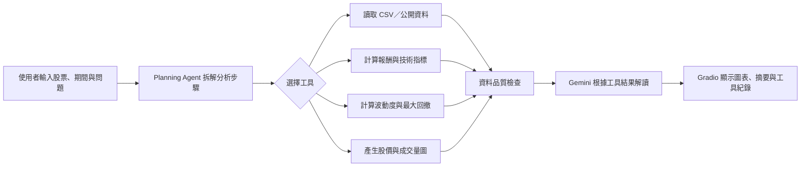

# StockLens：AI 股市歷史資料分析 Agent

StockLens 是一個以 **Tool Use** 與 **Planning** 為核心的課程期末專案。使用者輸入股票、日期區間與分析需求後，Agent 將規劃分析步驟，呼叫 Python 工具計算歷史報酬、移動平均、波動度與最大回撤，再透過 Gradio 顯示圖表、結果與工具紀錄。

> 本專案僅供課程展示、資料分析與學習使用，不構成投資建議或獲利保證。

## 目前狀態

- [x] 完成專案題目、流程與技術架構
- [x] 建立可離線執行的 CSV 分析原型
- [x] 建立資料驗證與歷史風險指標測試
- [ ] 串接 Gemini Function Calling／Planning
- [ ] 串接公開股票資料 API
- [ ] 加入雙股票比較與分析報告下載

目前的原型不需要股票 API 或 Gemini Key，只要上傳 CSV 即可分析；外部服務失效時仍能完成核心展示。

## 概念流程



## CSV 格式

必要欄位：

```text
Date,Open,High,Low,Close,Volume
```

`sample_data/demo_stock.csv` 是合成測試資料，不代表任何真實股票。

## 本機執行

```bash
python -m venv .venv
pip install -r requirements.txt
python app.py
```

執行後開啟終端機顯示的本機 Gradio 網址。

## 目前原型可完成

- 驗證必要欄位、日期、數值、缺失值與重複日期
- 依日期排序資料
- 計算期間報酬率
- 計算日波動度與年化歷史波動度
- 計算最大回撤
- 顯示 5 日及 20 日移動平均線
- 顯示分析結果與工具呼叫紀錄

## 預計工具

| 工具 | 用途 |
|---|---|
| `load_stock_csv` | 讀取歷史股價 CSV |
| `validate_stock_data` | 檢查欄位、日期與缺失值 |
| `calculate_metrics` | 計算報酬率、波動度與最大回撤 |
| `add_moving_averages` | 計算移動平均線 |
| `draw_stock_chart` | 產生股價及成交量圖 |
| `compare_stocks` | 比較兩檔股票的歷史表現（規劃中） |

## 資料來源規劃

第一階段使用使用者上傳的 CSV，以確保可重現與可離線展示。第二階段才評估串接：

- [臺灣證券交易所 OpenAPI](https://openapi.twse.com.tw/)
- [Alpha Vantage API](https://www.alphavantage.co/documentation/)

所有畫面都應標示資料日期及來源，不將延遲資料描述為即時行情。

## 專案限制

- 僅整理歷史資料，不能保證未來表現。
- 技術指標不是買賣訊號或投資建議。
- AI 文字可能出錯，重要數值以工具結果與原始資料為準。
- 系統不連接券商、不自動交易，也不代替使用者做投資決策。

完整專案規劃請見 [`docs/project-proposal.md`](docs/project-proposal.md)。

